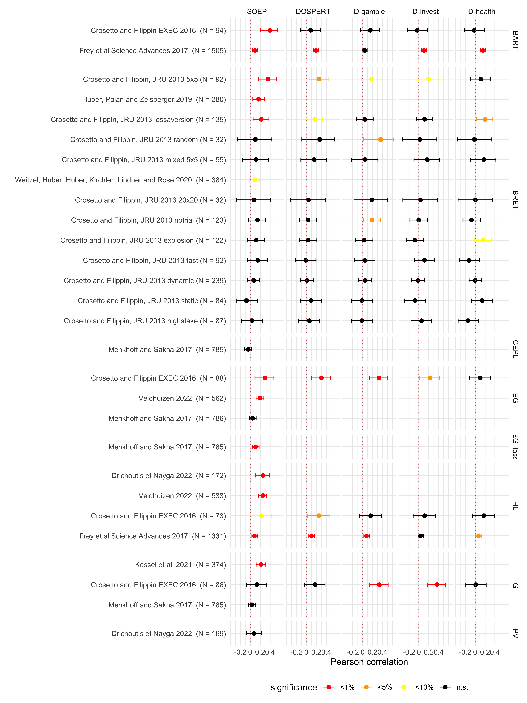

METARET – a Meta Analysis of the External Validity of Risk Elicitation
Tasks
================
Paolo Crosetto
This version: September 2026

This repository hosts all the development files of the METARET project
on the **external validity** of **risk elicitation tasks** (RETs) –
i.e. their ability to predict self-reported or real-world behavior.

## Aim of the project

The accurate measure of **risk preferences** is of large importance in
both theoretical and applied work. Despite this importance, increasing
experimental evidence points to the fact that the behavioral measures we
use to elicit risk attitudes have **low external validity**.

Lottery-based risk elicitation tasks (*RETs*), at least in the way they
are typically implemented in behavioral economics and psychology, 1.
**correlate poorly** with self-reported risk attitudes, real-world risk
behaviors, and among themselves; 2. introduce distinct **measurement
errors** and behavioral biases, and 3. are not robust to **test-retest**
exercises.

But the issue can not be settled by a handful of papers, that despite
all efforts are limited in sample size, and types of task and
questionnaires considered.

The good news is that the **data** to assess the external validity of a
large variety of RETs and a large variety of self-reported
questionnaires **already exists**. It sits in the drawers of dozens of
experimentlasits that have used RETs for their disparate aims. If
collected, the *existing data* would give us a detailed, precise, and
extensive **map of the external validity** of RETs under a variety of
experimental conditions.

The aim of METARET – the Meta-analysis of the external validity of RETs
– is to collect in a single, public, open repository all the data
pertaining to the external validity of RETs. Its objectives are to

- **document exhaustively** the scope and limits of the external
  validity of different RETs.
- provide a **detailed map** of which **features** of a RET are more
  conducive to external validity validity.
- serve as a basis for the **development** of a more predictive
  lottery-based RET (*French ANR grant under submission*).

METARET will collect data of papers that have run:

- any **lottery-based RET** (incentivized or not)
- any **other measure of risk** attitudes (questionnaire, bids in an
  auction, self-reported, implied by behavior in another game
  (insurance, trust…))
- any **self-declared real-world risky behaviour**.

The **metric** of interest will be (linear and rank) **correlations**
between any two RETs, any RET and any questionnaire, any RET and any
real-world behavior. For lottery-based RETs, *two* metrics will be used:
**bare choices** – whose domain and granularity change across tasks –
and **implied CRRA coefficients** of risk attitudes *r* – that are
burdened by theoretical assumptions but are more comparable across
tasks.

The aim is to be as **inclusive** as possible, to allow the map to cover
most possible ground – data availability will impose us to restrict
attention to certain broad class of RETs and of self-reported measures
in due time.

## Resources

METARET is composed of:

- a **shiny interactive app**
  [(here)](https://paolocrosetto.shinyapps.io/METARET_APP/) where the data
  accumulated so far can be explored and visualised;
- an **OSF page** [(here)](https://osf.io/h2z56/) where the project is
  being pre-registered;
- this **github repository** where the real work is done and updated,
  and that contains
  - **data** from each of several *contributed papers* by experimental
    economists and social psychologists.
  - **code** to format each original dataset into a common format for
    later analysis
  - **results** in the form of plots and tables
  - **code** for the interactive shiny app

## How to contribute

METARET is about **correlations**. So data need to be collected *within
subjects*. If you have experimental data that includes:

- two (or more) lottery-based **RETs**
- one (or more) RETs and one (or more) self-reported **questionnaires**
  (SOEP, DOSPERT, sensation seeking, other scales)
- one (or more) questionnaires or RET and **risk-related behavior** in
  another game/task (insurance, trust, strategic uncertainty, contests,
  competitiveness…)
- one (or more) RET or questionnaire and self-reported **real world risk
  attitudes** (health, sports, sexual behavior, smoking…)

then your data can be included in METARET.

To contribute:

- open a **git pull request** and push your data to the /Data folder, in
  an appropriately named subfolder;
- **send your raw data** (limited to the RET, questionnaires,
  risk-behavior data, subject ID) and a codebook to
  <paolo.crosetto@gmail.com> and I will upload it to this repository and
  the shiny app. Send along also the **published paper** that is based
  on that data, as well as any detail about the RET, the questionnaire,
  the sample that you might find relevant;
- **compute by yourself the correlations** and send them to
  <paolo.crosetto@gmail.com>

### Data dissemination and disclosure

This is an **open science project**. All data shared will be **made
public**. It will be available for external scrutiny, download, and
further use (upon citation and contact, CC NC-BY-SA):

- *static .csv files* and analysis scripts (mainly R and Stata), on this
  **github** repository;
- *dynamically explorable*, on the [shiny
  app](https://paolocrosetto.shinyapps.io/METARET_APP/).

If **you do not wish** your raw data to be disclosed but *still want to
contribute*, let me know. It is possible to include only the computed
correlations to the shiny app and the meta-analysis plots *without*
fully disclosing the individual data. Of course, with individual data
more is possible (distribution plots, large scatter plots, computation
of different utility functions, more measures…)

### Open science

METARET will be **developed in public**. As new papers and data sources
arrive, they will be added to the repository, cleaned, correlations will
be computed, and results will be fed to the [shiny
app](https://paolocrosetto.shinyapps.io/METARET_APP/). You will be able to
**track** the active development of the meta-analysis.

### Presentation

The methodology and first results of METARET were the object of a
special [semi-plenary
session](https://lessac.bsb-education.com/index.php?page=plenary)
organized by me at the [2019 Dijon European ESA
meeting](https://lessac.bsb-education.com/index.php?page=european-esa-meeting-dijon-sept-2019).

## Contributed papers (list updates as papers are contributed)

METARET started from two papers of mine – the [Bomb Risk Elicitation
Task](https://link.springer.com/article/10.1007/s11166-013-9170-z) (JRU,
2013) and [A Theoretical and Experimental Appraisal of Four Risk
Elicitation
Methods](https://link.springer.com/article/10.1007/s10683-015-9457-9)
(ExEc, 2016). The table below is built from the data itself, so it stays
current as papers arrive.

| Paper | Subjects | Tasks |
|:---|---:|:---|
| Abdellaoui et al. (2011) | 36 | HL |
| Amador Hidalgo et al. (2021) | 492 | HL |
| Andersen et al. (2008) | 100 | HL |
| Andersen et al. (2010) | 89 | HL |
| Apesteguia et al. (2020) | 176 | EG |
| Barrera and Simpson (2012) | 98 | HL |
| Bauernschuster et al. (2010) | 174 | HL |
| Bellemare and Shearer (2010) | 84 | HL |
| Branas-Garza and Rustichini (2011) | 145 | HL |
| Brañas-Garza et al. (2021) | 476 | HL |
| Brunner et al. (2014) | 318 | HL |
| Buser et al. (2021) | 784 | IG |
| Carlsson et al. (2009) | 213 | HL |
| Casari (2009) | 78 | HL |
| Chakravarty et al. (2011) | 37 | HL |
| Charness et al. (2019) | 861 | EG, HL, IG |
| Chen et al. (2013) | 72 | HL |
| Cobo-Reyes and Jimenez (2012) | 76 | HL |
| Costa-Gomes and Schoenegger (2022) | 1496 | BRET |
| Crosetto and Filippin (2013) | 1093 | BRET |
| Crosetto and Filippin (2016) | 341 | BART, EG, HL, IG |
| Csermely and Rabas (2016) | 96 | CEPL, EG, HL |
| Dannenberg et al. (2022) | 648 | IG |
| Dave et al. (2010) | 802 | HL |
| Deck et al. (2012) | 47 | HL |
| Dickinson (2009) | 126 | HL |
| Drichoutis (2012) | 57 | HL |
| Drichoutis and Nayga (2013) | 86 | HL, PV |
| Drichoutis and Nayga (2022) | 313 | HL, PV |
| Drichoutis et al. (2021) | 127 | questionnaire only |
| Duersch et al. (2012) | 200 | HL |
| Dursch et al. (2017) | 133 | HL |
| Eckel and Wilson (2006) | 198 | HL |
| Erkal, Gangadharan, and Koh (2018) | 156 | IG |
| Erkal, Gangadharan, and Koh (2020) | 114 | CEPL |
| Erkal, Gangadharan, and Koh (2022) | 775 | IG |
| Ert and Haruvy (2017) | 60 | HL |
| Fairley and Parelman (2019) | 158 | BART, BERP |
| Fiedler and Gloeckner (2012) | 29 | HL |
| Fiore et al. (2009) | 40 | HL |
| Frey et al. (2017) | 1506 | BART, HL |
| Gloeckner and Hilbig (2012) | 159 | HL |
| Gloeckner and Pachur (2012) | 38 | HL |
| Gnambs et al. (2015) | 146 | BART |
| Grijalva et al. (2011) | 77 | HL |
| Harrison et al. (2005) | 152 | HL |
| Harrison et al. (2007) | 18 | HL |
| Harrison et al. (2013) | 90 | HL |
| Holt and Laury (2002) | 199 | HL |
| Holzmeister and Stefan (2019) | 198 | BRET, CEPL, EG, HL |
| Hopfensitz et al. (2019) | 72 | EG |
| Huber, Palan and Zeisberger (2019) | 280 | BRET |
| Jacquemet et al. (2008) | 87 | HL |
| Jamison et al. (2008) | 130 | HL |
| Kersting et al. (2019) | 199 | EG |
| Kessel et al. (2021) | 374 | IG |
| Kirchkamp et al. (2021) | 178 | EG, HL |
| Lange et al. (2007a) | 121 | HL |
| Lange et al. (2007b) | 172 | HL |
| Levy-Garboua et al. (2012) | 54 | HL |
| Lusk and Coble (2005) | 47 | HL |
| Masclet et al. (2009) | 79 | HL |
| Menkhoff and Sakha (2017) | 786 | CEPL, EG, EG_loss, IG |
| Mueller and Schwieren (2012) | 116 | HL |
| Nieken and Schmitz (2012) | 287 | HL |
| Nielsen (2019) | 1818 | BRET |
| Pogrebna et al. (2011) | 57 | HL |
| Ponti and Carbone (2009) | 33 | HL |
| Proto et al. (2018) | 215 | HL |
| Rommel et al. (2019) | 133 | HL |
| Rosaz (2012) | 112 | HL |
| Rosaz and Villeval (2012) | 279 | HL |
| Roth et al. (2016) | 104 | HL |
| Ryvkin (2011) | 42 | HL |
| Schmidt et al. (2019) | 158 | EG |
| Schram and Sonnemans (2011) | 137 | HL |
| Shachat (2021) | 566 | CEPL |
| Shafran (2010) | 64 | HL |
| Slonim and Guillen (2010) | 116 | HL |
| Sloof and van Praag (2010) | 86 | HL |
| Szrek et al. (2012) | 198 | HL |
| Trutmann et al. (2023) | 167 | questionnaire only |
| Veldhuizen (2022) | 562 | EG, HL |
| Wakolbinger and Haigner (2009) | 131 | HL |
| Weitzel, Huber, Huber, Kirchler, Lindner and Rose (2020) | 384 | BRET |
| Yechiam and Hochman (2013) | 11 | HL |
| Zhou and Hey (2018) | 91 | CEPL |

### First look at the results

As a first step, I compute the (Pearson) correlation of each RET to
(each of a series of) self-reported risk measures.

Each task is represented by a point estimate + confidence interval. Here
are the results of correlations between several tasks and:

- the SOEP risk question
- the DOSPERT scale and its subscales

The plots and analyses are updated for each new contributed paper. An
interactive version fo the same data is to be found at the [shiny
app](https://paolocrosetto.shinyapps.io/METARET_APP/)

<!-- -->
